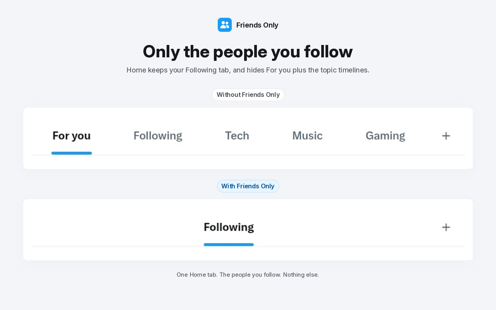
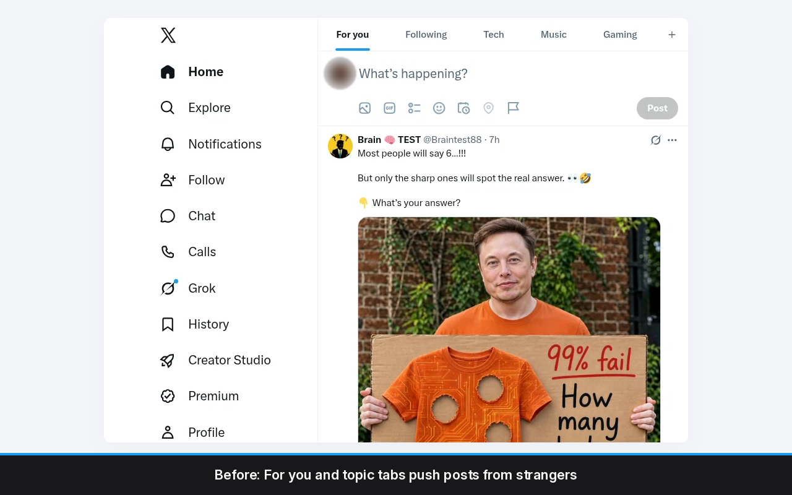
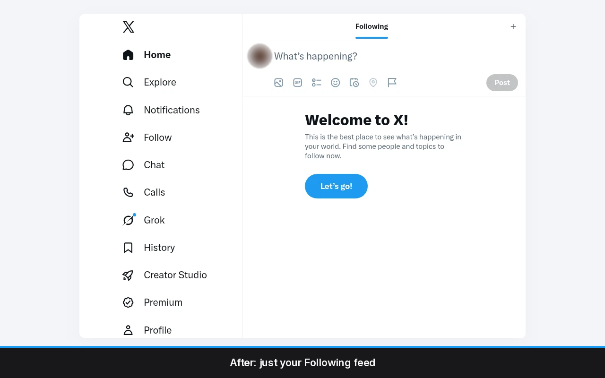
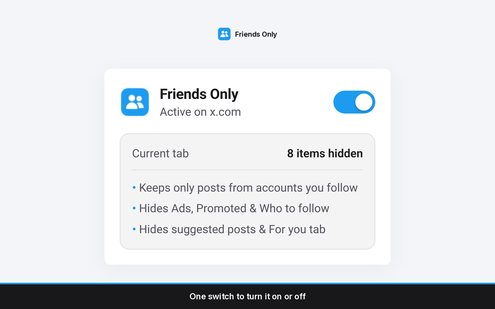

# Friends Only

**Friends Only** is a lightweight cross-browser Manifest V3 extension for **Chrome** and **Firefox** that keeps your `x.com` Home timeline strictly limited to accounts you actually follow — hiding ads, "Who to follow", suggested posts, unfollowed accounts, and the "For you" and topic timeline tabs as you scroll.

## Features

- **Friends-only Home timeline**: Uses X's own relationship state alongside DOM inspection to hide every post on the Home timeline that is not authored by an account you follow (including reposts of unfollowed accounts), while keeping your own posts and followed friends' quote posts intact.
- **Blocks Ads & Promoted posts**: Hides posts and placements labeled `Ad`, `Promoted`, `Sponsored`, or backed by `placementTracking` / `promotedMetadata`.
- **Removes "Who to follow"**: Hides inline timeline "Who to follow" / "Creators for you" modules (headings, `UserCell` rows, and "Show more" footers) as well as the right-sidebar "Who to follow" card.
- **Eliminates suggested posts**: Hides algorithmic recommendations ("Suggested for you", "Popular", "<User> liked", "<User> followed", Topic suggestions, and posts with inline Follow buttons).
- **Hides "For you" & custom topic tabs**: Hides `For you` and custom topic timeline tabs on Home (such as `Tech`, `Music`, `Gaming`), suppresses non-`Following` feed content immediately so algorithmic posts never flash, and automatically selects `Following`.
- **Smooth `MutationObserver` scrolling**: Watches X's virtualized timeline (`cellInnerDiv`) as you scroll, collapsing hidden cells cleanly to `0px` so X's `ResizeObserver` leaves no blank gaps, and unmarking recycled DOM nodes when X rebinds them to followed friends' posts.
- **Non-Home pages untouched**: Profiles, post threads/replies, Search, Explore, Bookmarks, and Lists work normally without hiding posts.
- **Instant On/Off Popup**: Toggle filtering on or off from the toolbar popup (`storage.local`), taking effect immediately on open `x.com` tabs without reloading.
- **Chrome & Firefox MV3 Compatible**: Single `manifest.json` with `browser_specific_settings.gecko`, dual `background` (`service_worker` for Chrome + `scripts` event page for Firefox), and Promise-based `browser` / `chrome` WebExtension APIs.

## Project Structure

- `manifest.json` — Cross-browser Manifest V3 extension definition (Chrome + Firefox 128+)
- `background.js` — Background worker/event page managing `storage.local` default state and toolbar `OFF` badge
- `page-bridge.js` — `MAIN`-world observer that passively reads X's GraphQL / Redux / React Fiber relationship metadata (`following`, `promotedMetadata`, `socialContext`)
- `content.css` — Scoped zero-flash CSS rules (`html[data-friends-only="true"][data-friends-only-home="true"]`) injected at `document_start`
- `content.js` — Content script with Home timeline detection, `For you` -> `Following` tab switching, and `MutationObserver` DOM scanner
- `popup.html`, `popup.css`, `popup.js` — Toolbar popup UI with persistent On/Off switch, hidden-item counter, and Firefox host-permission check
- `icons/` — Extension icons (`16`, `32`, `48`, `128` px)
- `screenshots/` — Store listing and before/after screenshots

## Screenshots

### Before

### After

### Popup Toggle

## Loading Unpacked in Chrome

No build step is required. Load this folder directly into Chrome:

1. Open Google Chrome and navigate to `chrome://extensions`.
2. Turn on **Developer mode** using the toggle in the top-right corner.
3. Click **Load unpacked** in the top-left toolbar.
4. Select this project directory (the folder containing `manifest.json`).
5. *(Optional)* Click the puzzle-piece **Extensions** icon in Chrome's toolbar and pin **Friends Only** for quick access to the On/Off toggle.

## Loading Temporarily in Firefox

1. Open Firefox (128 or newer) and navigate to `about:debugging#/runtime/this-firefox`.
2. Click **Load Temporary Add-on…**.
3. Select `manifest.json` inside this project directory.
4. *(Optional)* Click the puzzle-piece **Extensions** button in Firefox's toolbar, open the gear menu next to **Friends Only**, and click **Pin to Toolbar** (if Firefox prompts for `x.com` site access, allow it or click **Allow on x.com** inside the popup).

## How to Test

1. Visit `https://x.com/home` — verify the `For you` tab is hidden, the timeline automatically selects `Following`, and the right-sidebar `Who to follow` box is gone.
2. Scroll down your Home feed — verify Ads (`Ad` / `Promoted`), inline `Who to follow` modules, suggested posts, and posts from accounts you do not follow are hidden without leaving empty gaps.
3. Visit any user profile or post thread (`https://x.com/<username>/status/<id>`) — verify posts and replies from unfollowed accounts remain visible outside the Home timeline.
4. Click the **Friends Only** toolbar icon and toggle the switch off/on — verify hidden items reappear and disappear immediately without refreshing the page.
